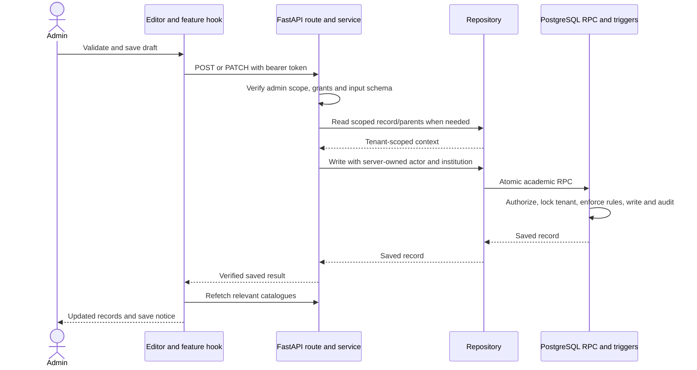

# Academic Setup application architecture

[Reading guide](README.md) · [Security and lifecycle](SECURITY_AND_LIFECYCLE.md)

## Architectural shape

This feature is a React/TypeScript workspace backed by a layered FastAPI
application and Supabase PostgreSQL. Its two API families reuse the same
authentication, permission resources, database client and tenant write lock.
Academic Setup is implemented inside the existing application; these layers are
not separately deployed academic microservices.

| Layer               | Responsibility                                                    | Academic owner                                                                |
| ------------------- | ----------------------------------------------------------------- | ----------------------------------------------------------------------------- |
| Workspace and pages | Navigation, composition, tables, summaries and drawers            | `frontend/src/features/admin/academic-setup/`                                 |
| Feature hooks       | Drafts, filters, permissions, reads, saves and refresh behavior   | Hooks beside their owning pages                                               |
| Transport           | Bearer headers, JSON requests and public errors                   | `frontend/src/services/admin/academics.ts`, `academicStructure.ts`, `http.ts` |
| Frontend contracts  | Entity names and typed create/update/response shapes              | `frontend/src/types/academicSetup.ts`, `academicStructure.ts`                 |
| HTTP API            | Role dependency, entity/path parsing and validation responses     | `backend/app/api/academics/`                                                  |
| Business services   | Scope, permissions, lifecycle checks and orchestration            | `backend/app/services/academics/`                                             |
| Repositories        | Tenant-filtered queries, projections and RPC calls                | `backend/app/repositories/academics/`                                         |
| Backend contracts   | Pydantic validation and immutable update fields                   | `backend/app/schemas/academics/`                                              |
| Database            | Authoritative relationships, lifecycle, locking, writes and audit | `supabase/migration_sources/academic_export/`, `academic_workspace/`          |

## Frontend composition and navigation

`AdminShell` stores the selected administrator view, academic subpage and search
text. Opening Academic Setup mounts `AcademicWorkspace`. Its dispatcher chooses
the overview, dedicated foundation pages, calendar, curriculum, batches, sections,
shared structure pages or Existing Academic Catalogues.

Academic subpages currently use local React state. They are not individually
addressable browser routes; refresh does not restore a specific academic subpage
from the URL. Academic search returns to the overview and searches readable
foundation and workspace records, plus the management-area descriptions.

| Frontend area                            | Implementation responsibility                                                                         |
| ---------------------------------------- | ----------------------------------------------------------------------------------------------------- |
| `overview/`                              | Workspace dispatch, academic sidebar, search, management cards, shortcuts, counts and recent activity |
| `departments/`, `programs/`, `subjects/` | Dedicated lists, filters, add/view/edit drawers and local validation                                  |
| `calendar/`                              | Year/term views, dates, timeline and checkpointed multi-record creation                               |
| `curriculum/versioning/`                 | Version list, mapping selection, publication history and existing-mapping tab                         |
| `batches/`                               | Cohort view model, persisted adapter and fixed curriculum assignment                                  |
| `sections/`                              | Cohort-owned section adapter, stage/term selection and editor                                         |
| `structure/`                             | Shared structure reads, write guards, declarative fields, generic record table and drawer             |
| `forms/`                                 | Existing catalogue controls, relationships and shared subject-type labels                             |
| `dialogs/`, `transitions/`               | Modal focus lifecycle and lifecycle/discard confirmation UI                                           |

The Batches and Sections adapters translate backend names and nullable values
into focused UI models. Their `studentCount` is explicitly null because enrollment
is not connected. They do not use browser storage as an academic database.

## State ownership

Persistent academic state belongs to PostgreSQL. TanStack Query owns fetched
catalogues. Component/feature-hook state owns filters, pagination, drawer mode,
unsaved entries, confirmation state, request locks and local save notices.

The workspace identity includes session generation, user ID, institution ID and
effective permissions. React keys remount the academic session when that identity
changes. Same-session token renewal preserves the generation; replacement login,
tenant or grants creates a different workspace and discards old local drafts.
For older contexts without generation, identity falls back to the token.

The retained `AcademicSetup` generic catalogue also has its own inner key that
includes the raw access token. That form remounts on token renewal even when the
outer workspace generation is unchanged. Draft preservation on same-session
renewal therefore describes the newer workspace pages, not that generic form.

Late-save callbacks check whether their owning session is still mounted. The
shared structure writer also uses a synchronous ref lock to prevent two saves
starting before the saving state has rerendered. This prevents UI callbacks from
modifying a replacement session; it does not undo an already committed database write.

## Catalogue queries and reconciliation

| Query                      | Key prefix                              | Current lifetime                                                                            |
| -------------------------- | --------------------------------------- | ------------------------------------------------------------------------------------------- |
| Shared foundations         | `admin / academic-overview / identity`  | `useApiQuery` adds a per-instance suffix; refetch on mount and no retained navigation cache |
| Additive structure         | `admin / academic-structure / identity` | Navigation cache: 60-second freshness and 5-minute inactive retention                       |
| Existing generic catalogue | `admin / academic-setup / identity`     | Per-instance query without retained navigation cache                                        |

`useAcademicStructure` composes both the foundation and structure queries, checks
response institution IDs, filters workspace records to that institution and hides
data on recognized authorization failures. It exposes availability, loading,
refreshing, denied/error state and server-advertised management capability.

The wrapper disables automatic retries. Changes are blocked while these composed
queries refresh or have errors. A successful shared structure write verifies the
returned institution and primary key, then refetches both catalogues. Dedicated
foundation editors refresh their own foundation query after saving.

This is not one shared cache for all academic data. Foundation calls can be
duplicated across hook instances; separately retained structure data may remain
fresh according to its cache timer after a foundation change. See the cache
reconciliation proposal in [Design review](DESIGN_REVIEW.md).

## Public API surface

Paths below include the application's `/api/v1` prefix. The frontend's API base
can be configured, but the academic endpoint suffixes remain the same.

| Operation                | Foundation/export API                                     | Additive workspace API                                        |
| ------------------------ | --------------------------------------------------------- | ------------------------------------------------------------- |
| Read permitted catalogue | `GET /api/v1/admin/academic-setup`                        | `GET /api/v1/admin/academic-structure`                        |
| Create record            | `POST /api/v1/admin/academic-setup/{entity}`              | `POST /api/v1/admin/academic-structure/{entity}`              |
| Update record            | `PATCH /api/v1/admin/academic-setup/{entity}/{record_id}` | `PATCH /api/v1/admin/academic-structure/{entity}/{record_id}` |

Creation returns HTTP 201; successful catalogue reads and updates return 200.
There is no academic DELETE endpoint, public single-record GET, bulk setup
transaction, automatic promotion endpoint or dedicated publish endpoint.
Publication is a curriculum-version PATCH with a status change.

The first family accepts the eight entities in `AcademicEntity`; the second
accepts the six in `StructureEntity`. Unknown entity names are validation errors.
UUIDs identify records. Pydantic rejects extra fields, empty patches, invalid
types and parent fields absent from that entity's update contract.

Catalogue responses include `institution_id`, a `records` dictionary and a
`manageable` entity list. An omitted entity means it is not readable through that
response; an empty array means it was readable and contained no records.
`manageable` is the server's UI capability hint, not a substitute for write checks.
The workspace response also includes up to 20 permitted recent academic activities.

## Read path

1. `requestJson` attaches the bearer token and calls the catalogue endpoint.
2. The route requires institution administrator authority.
3. The service derives institution scope and permitted entity resources.
4. It validates active institution/organization ancestry and scoped grants.
5. The repository reads only permitted entities and filters them by tenant.
6. Foundation descendants use parent joins to establish ownership; the API adds
   a derived `institution_id`. Workspace tables filter their physical tenant column.
7. The response returns only public projections and manageable entity names.
8. Hooks verify the response tenant, then pages derive counts, choices and rows.

Repositories use `read_all`, which fetches in 500-row ranges until complete.
The HTTP response still contains the complete permitted catalogue. Current
pagination and most filtering happen in the browser, not in list API parameters.
Separate table reads are not one consistent database snapshot under concurrent edits.

## Write path

Foundation services perform additional active-parent and calendar checks before
the RPC. Year/term partial patches are validated against persisted values.
Workspace services validate contracts and scoped record existence, then rely on
the database for atomic relationship/publication validation. Database enforcement
protects against races after those earlier service reads.

## Errors and recovery

| Result | Public meaning                                                                  |
| ------ | ------------------------------------------------------------------------------- |
| 401    | Authentication rejected; transport raises a token-specific session-expiry event |
| 403    | Academic grants, admin scope or active tenant/organization checks failed        |
| 404    | Record/parent unavailable in the selected tenant                                |
| 409    | Duplicate identity/relationship or active year date overlap                     |
| 422    | Invalid request, immutable field, hierarchy, dates, numeric input or dependency |
| 503    | Required academic table/column/function is unavailable                          |
| 500    | Unrecognized failure or invalid database response                               |

Transport failures become typed `AdminApiError` values. Known database codes are
translated to public errors without raw SQL details. The shared hierarchy message
does not currently identify every blocking child; the UI often needs a catalogue
review to resolve it. A committed write followed by a failed refetch is also a
distinct recovery case worth testing.

Sources: [workspace dispatcher](../../../frontend/src/features/admin/academic-setup/overview/AcademicWorkspace.tsx),
[query wrapper](../../../frontend/src/hooks/useApiQuery.ts),
[query policy](../../../frontend/src/lib/queryClient.ts),
[composed structure hook](../../../frontend/src/features/admin/academic-setup/structure/useAcademicStructure.ts),
[shared writer](../../../frontend/src/features/admin/academic-setup/structure/useStructureWrite.ts),
[foundation service](../../../backend/app/services/academics/academic_setup.py),
[structure service](../../../backend/app/services/academics/academic_structure.py),
[repository paging](../../../backend/app/repositories/shared/query_pages.py) and
[error translation](../../../backend/app/services/academics/database_errors.py).
