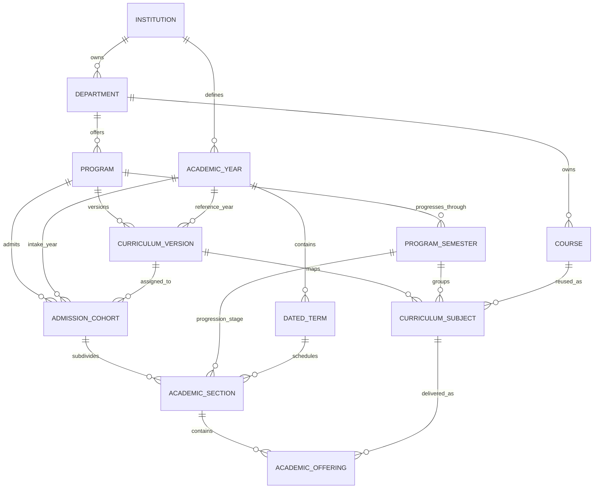

# Academic Setup domain model

[Reading guide](README.md) · [Workflows](WORKFLOWS.md)

## Vocabulary

| Product term      | Storage term         | Meaning                                                           |
| ----------------- | -------------------- | ----------------------------------------------------------------- |
| Program           | `programs`           | A degree offered by a department, such as B.Tech Computer Science |
| Subject           | `courses`            | A reusable subject such as Data Structures                        |
| Academic term     | `semesters`          | A dated teaching period within an academic year                   |
| Program semester  | `program_semesters`  | A numbered progression stage within a degree                      |
| Batch             | `admission_cohorts`  | An intake group assigned to one published curriculum              |
| Academic section  | `academic_sections`  | A batch subdivision in one progression stage and dated term       |
| Academic offering | `academic_offerings` | One curriculum subject delivered within an academic section       |
| Existing section  | `sections`           | A subdivision of one existing course offering                     |

The same dated term can teach different progression stages for different batches.
For example, the August–December 2027 term could contain Semester 3 for the 2026
intake and Semester 1 for the 2027 intake. A progression stage has no dates itself.

## Shared foundation entities

| Entity / primary key                  | Main data                                                                                               | Ownership and purpose                                                                                                      |
| ------------------------------------- | ------------------------------------------------------------------------------------------------------- | -------------------------------------------------------------------------------------------------------------------------- |
| `departments` / `department_id`       | Name, code, description, active flag                                                                    | Institution-owned academic department; the database also retains optional campus ancestry, which these forms do not manage |
| `programs` / `program_id`             | Name, code, description, degree type, duration, optional total credits, active flag                     | Belongs to one department; defines the degree                                                                              |
| `academic_years` / `academic_year_id` | Name, code, start/end dates, current and active flags                                                   | Institution-owned calendar year                                                                                            |
| `semesters` / `semester_id`           | Year, name, code, term number, dates, current and active flags                                          | Belongs to one academic year; defines dated teaching time                                                                  |
| `courses` / `course_id`               | Department, name, code, description, nullable credits and lecture/tutorial/practical hours, active flag | Department-owned reusable subject                                                                                          |

Subject type and required/optional status belong to a curriculum mapping, not to
the reusable subject. The same subject can be core in one curriculum and elective
in another. Cross-department subjects are possible within the same institution;
the relationships require matching tenants, not matching departments.

## Versioned workspace entities

| Entity / primary key                            | Main data                                                                                                                       | Relationship                                                  |
| ----------------------------------------------- | ------------------------------------------------------------------------------------------------------------------------------- | ------------------------------------------------------------- |
| `program_semesters` / `program_semester_id`     | Program, name, code, number, active flag                                                                                        | Reusable progression stage owned by a program                 |
| `curriculum_versions` / `curriculum_version_id` | Program, reference academic year, name, version label, total semesters, description, status, active flag, publication timestamp | A version of a program's subject structure                    |
| `curriculum_subjects` / `curriculum_subject_id` | Curriculum version, program semester, subject, type, required flag, active flag                                                 | One subject's place in one version and progression stage      |
| `admission_cohorts` / `admission_cohort_id`     | Program, assigned curriculum, intake year, name, code, start/end years, expected count, description, status                     | One admission batch with a fixed curriculum assignment        |
| `academic_sections` / `academic_section_id`     | Batch, program semester, dated term, name, code, capacity, description, active flag                                             | One class section for one progression stage and teaching term |
| `academic_offerings` / `academic_offering_id`   | Academic section, curriculum subject, capacity, active flag                                                                     | A subject offered to that section                             |

All six workspace tables physically store `institution_id`, `created_at` and
`updated_at`. API clients cannot choose the institution or generated timestamps.

## Relationship diagram

This diagram describes record relationships. The batch itself does not currently
contain student memberships, and an offering does not contain a teacher assignment.

## Existing catalogue relationships

| Entity             | Relationship and purpose                                                                                              |
| ------------------ | --------------------------------------------------------------------------------------------------------------------- |
| `program_courses`  | Links a program and reusable subject, optionally restricted to one dated term; stores type, required and active flags |
| `course_offerings` | Selects subject, program, academic year and dated term; requires a matching active program-course link                |
| `sections`         | Belongs to exactly one `course_offering`; stores name, code, capacity and active flag                                 |

An existing program-course pair is unique even when the term field is present.
It cannot hold separate rows for the same subject in multiple terms. A null term
means its link can support offerings in different dated terms. This differs from
versioned mappings, where the same subject can appear in different progression
stages or curriculum versions.

Existing records remain available through Existing Academic Catalogues and
Curriculum → Legacy program mappings. They are not inputs to the versioned
offering path, which uses `curriculum_subject_id` instead.

## Identity, uniqueness and history

All entities use UUID primary keys. Most codes also have case-insensitive,
whitespace-trimmed unique indexes, with the scope shown below. Deactivation does
not remove these unique keys; reuse/reactivate the original record when appropriate.

| Record                       | Unique business identity                                                  |
| ---------------------------- | ------------------------------------------------------------------------- |
| Department / academic year   | Code within institution                                                   |
| Program / reusable subject   | Code within department                                                    |
| Dated term                   | Code and term number within academic year                                 |
| Existing program-course link | Program + subject                                                         |
| Existing course offering     | Subject + program + academic year + dated term                            |
| Existing section             | Code within its course offering                                           |
| Program semester             | Code and progression number within program                                |
| Curriculum version           | Version label within program, including versions in other reference years |
| Curriculum subject           | Version + program semester + subject                                      |
| Batch / academic section     | Code within institution                                                   |
| Academic offering            | Academic section + curriculum subject                                     |

An academic section code must therefore distinguish the batch/stage/term when
those represent different records. Repeatedly creating a section called “A” is
possible, but repeatedly using the same institution-wide code is not.

## Immutable assignments

| Record                       | Cannot change through the update API                                              |
| ---------------------------- | --------------------------------------------------------------------------------- |
| Program / subject            | Owning department                                                                 |
| Dated term                   | Owning academic year                                                              |
| Existing program-course link | Program, subject and optional dated term                                          |
| Existing offering / section  | Offering ancestry; a section also retains its code                                |
| Program semester             | Program and progression number                                                    |
| Curriculum version           | Program, reference year, version label and total semester count, even while draft |
| Curriculum subject           | Version, progression stage and reusable subject                                   |
| Batch                        | Program, curriculum assignment, intake year, start year and end year              |
| Academic section             | Batch, progression stage, dated term and code                                     |
| Academic offering            | Section and curriculum subject                                                    |

A wrong assignment generally requires another correctly related record and
retirement of the incorrect record where lifecycle rules allow it. It is not a
transfer or reparent operation. Batch codes and program-semester codes remain
editable; academic-section codes do not.

## Dates, numbers and states

- End dates must follow start dates; term dates must fit their year.
- Active academic-year date ranges cannot overlap, including shared endpoints.
- There is at most one current year per institution and one current dated term
  per academic year. Current records must be active.
- Dated terms have positive numbers; progression numbers and curriculum total
  semesters are limited to 1–32.
- Subject credits are nullable and positive when supplied. Teaching hours are
  nullable and nonnegative. They may be fractional.
- Workspace capacities and expected intake are nullable, nonnegative integers.
  Existing offering/section capacities must be positive when supplied.
- Cohort start/end years form an ordered span within the database's 1900–2200
  boundary. The API does not derive the span from program duration.
- Curriculum states are `draft`, `published`, `archived`. Batch states are
  `active`, `completed`, `inactive`; its active flag is generated from status.
- Academic sections and offerings currently use an active boolean. Planned,
  closed and cancelled states are not implemented lifecycle states for them.

Program total credits, curriculum subject credits, batch expected count and
section/offering capacities are not automatically reconciled by this model.
No enrolled-student count is stored by these entities.

## What publication preserves

Publishing records a timestamp and freezes curriculum metadata and subject
mappings. A batch retains its assigned version when it is archived. Publication
does **not** copy subject names, credits, descriptions or hours into the version:
those remain references to editable `courses` rows. Labels for referenced
programs and program semesters can also change. Review this distinction before
using a published version as an immutable transcript or accreditation snapshot.

Sources: [foundation contracts](../../../backend/app/schemas/academics/academic_setup.py),
[workspace contracts](../../../backend/app/schemas/academics/academic_structure.py),
[foundation keys](../../../supabase/migration_sources/academic_export/constraints.sql),
[normalized indexes](../../../supabase/migration_sources/academic_export/indexes.sql),
[workspace tables](../../../supabase/migration_sources/academic_workspace/tables.sql) and
[workspace lifecycle](../../../supabase/migration_sources/academic_workspace/lifecycle.sql).
