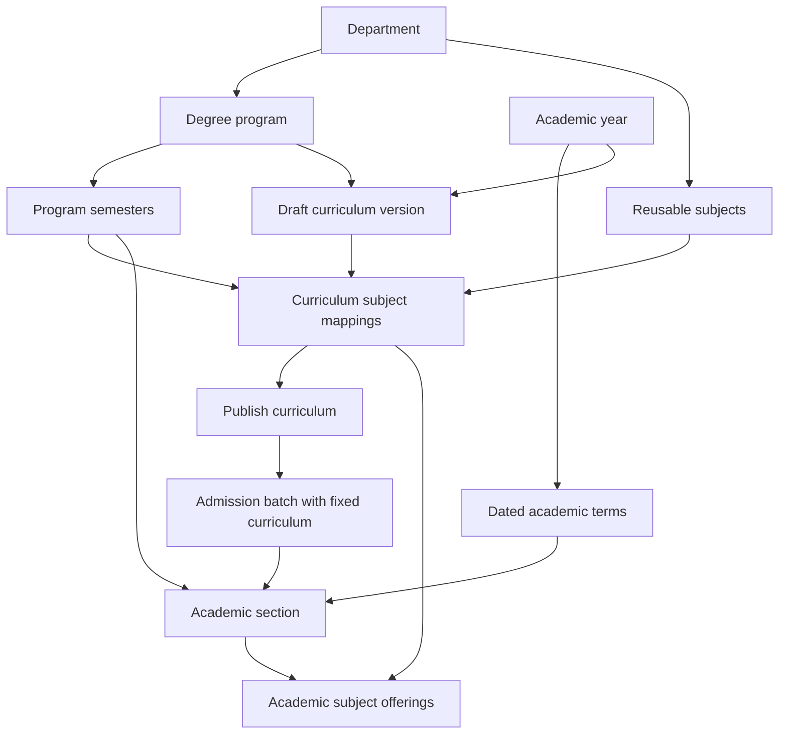

# Academic Setup: architecture and workflow record

Recorded on **28 October 2026** from the repository working tree, based on commit
`93fafa4`. This describes the implemented application and migration sources.
It is a source review, not a fresh certification of a deployed database.

## Purpose

Academic Setup defines what an institution teaches, how programs progress,
which curriculum an admission batch follows, and which subjects a class section
offers in a particular teaching term. Administrators build this structure before
later operational workflows can attach students, teachers, attendance or results.

The design separates reusable academic definitions from dated delivery:

- A **subject** is reusable teaching content, stored as a `course`.
- A **program semester** is a progression stage such as Semester 3.
- An **academic term** is a dated period, stored as a `semester`.
- A **curriculum version** assigns subjects to progression stages.
- A **batch** retains one published curriculum throughout its history.
- An **academic section** places a batch in a progression stage and dated term.
- An **academic offering** delivers one mapped subject inside that section.

## Reading guide

| Document                                                | Use it to review                                                                 |
| ------------------------------------------------------- | -------------------------------------------------------------------------------- |
| [Domain model](DOMAIN_MODEL.md)                         | All entities, relationships, terminology, keys and immutable assignments         |
| [Workflows](WORKFLOWS.md)                               | Setup order, example records, publishing, term rollover and failure recovery     |
| [Application architecture](APPLICATION_ARCHITECTURE.md) | Frontend composition, state, API contracts, backend layers and request sequences |
| [Security and lifecycle](SECURITY_AND_LIFECYCLE.md)     | Permissions, tenant isolation, database transactions, audit and retirement rules |
| [Design review](DESIGN_REVIEW.md)                       | Current UI, architectural tradeoffs, gaps and proposed improvements              |
| [Verification and source map](VERIFICATION.md)          | Owning files, migrations, test coverage and verification boundaries              |

Read the model and workflows first. Use the architecture and security documents
when planning code changes. Improvements in the review document are proposals;
they are not claims that those capabilities already exist.

## Main workflow

The curriculum's academic year records its reference year. The batch has its own
intake academic year. A section's dated term supplies the delivery year. These
references have different meanings and need not all point to the same year.

## System architecture

```mermaid
flowchart LR
    A[Institution administrator] --> UI[React academic workspace]
    UI --> H[Feature hooks and TanStack Query]
    H --> HTTP[Typed service clients with bearer token]
    HTTP --> API[FastAPI routes and verified admin scope]
    API --> SVC[Services: permissions and validation]
    SVC --> REP[Repositories: tenant-filtered reads and RPCs]
    REP --> DB[(Supabase PostgreSQL)]
    DB --> G[Constraints and lifecycle triggers]
    G --> AUDIT[Atomic academic audit]
```

Reads go through backend repositories. Writes go through one of two audited
database functions. Browser clients do not access academic tables directly.

## Why there are two academic models

The application preserves the owner's export-aligned eight-table catalogue:
departments, programs, academic years, dated semesters, courses, program-course
links, course offerings and offering-owned sections.

An additive workspace introduces six tables for progression semesters, curriculum
versions, curriculum subject mappings, admission cohorts, cohort-owned sections
and academic offerings. The first five catalogue entities are shared foundations.
Together they support the **eleven principal workspace entities**, while three
additional catalogue entities remain accessible for compatibility.

| Workflow            | Curriculum relationship                 | Delivery relationship                         |
| ------------------- | --------------------------------------- | --------------------------------------------- |
| Versioned workspace | Version + program semester + subject    | Batch → academic section → academic offerings |
| Existing catalogue  | Program + subject + optional dated term | Course offering → offering-owned sections     |

These are distinct structures. The application does not automatically synchronize
their mappings or convert their section records. A new versioned workflow does
not require creating a legacy `program_courses` link first.

## Scope and present limits

The active setup supports catalogue maintenance, curriculum publication/history,
fixed batch assignments, dated class sections, subject offerings and recent
academic activity. Changes use soft lifecycle states to preserve references.

Enrollment, student-to-section membership, faculty teaching assignment,
attendance, examinations, marks/results and program-outcome authoring are outside
this implementation. Student account approval remains a separate active workflow.
Expected intake and maximum capacity are planning values; actual enrolled totals
remain unavailable until an enrollment source is connected.

The principal design decisions to review are historical subject metadata,
retirement of published structures, publication completeness, recovery after
uncertain saves, cache reconciliation and catalogue growth. Each is explained
with source evidence and a proposed acceptance condition in [Design review](DESIGN_REVIEW.md).

## Maintaining this record

Update the relevant page when an entity, public contract, lifecycle rule or
workflow changes. Preserve the distinction between implemented behavior,
historical deployment evidence and proposed work. Keep each document within
250 physical lines and this folder within 15 directly contained files.

Related guides: [frontend integration design](../../../frontend/docs/ACADEMIC_SETUP_DESIGN.md),
[frontend structure](../../../frontend/docs/STRUCTURE.md),
[backend structure](../../../backend/STRUCTURE.md) and
[academic retirement history](../../retirements/academic-setup/README.md).
