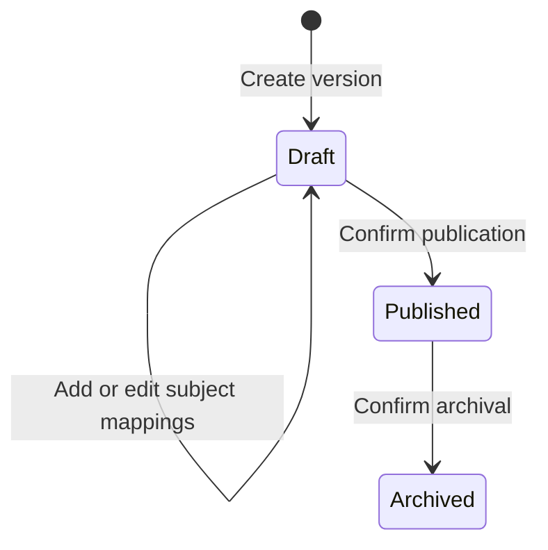
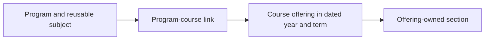

# Academic Setup workflows

[Reading guide](README.md) · [Domain model](DOMAIN_MODEL.md)

The following example is illustrative; this documentation creates no sample data.
Each successful save commits a real record through the normal backend API.

## Before starting

Use an active institution administrator with the relevant academic read/manage
permissions. The institution and its organization must be active. The server
selects the institution from authenticated scope. Academic Setup can appear in
administrator navigation without academic grants, but data and actions remain gated.

## Set up a new program and intake

| Step | Administrator action      | Example and saved result                         | Prerequisite / rule                                                                 |
| ---- | ------------------------- | ------------------------------------------------ | ----------------------------------------------------------------------------------- |
| 1    | Add a department          | Computer Science, `CSE`                          | Active institution                                                                  |
| 2    | Add a degree program      | B.Tech CSE, `BTCSE`, 4 years                     | Active department; department remains fixed                                         |
| 3    | Create an academic year   | 2026–27, 1 Aug 2026–31 Jul 2027                  | No overlap with another active year                                                 |
| 4    | Create dated terms        | Term 1: Aug–Dec 2026; Term 2: Jan–Jul 2027       | Dates fit the year; number/code unique in that year                                 |
| 5    | Add reusable subjects     | Programming `CS101`, Mathematics `MA101`         | Active owning departments; credits/hours optional                                   |
| 6    | Add program semesters     | Semester 1 `S1` through Semester 8 `S8`          | Same active degree program; these stages have no dates                              |
| 7    | Create a curriculum draft | B.Tech CSE 2026, version `2026.1`, 8 semesters   | Active program and reference academic year                                          |
| 8    | Map curriculum subjects   | `CS101` → Semester 1, core, required             | Version is draft; stage belongs to its program and fits total semesters             |
| 9    | Publish the curriculum    | Status becomes `published`; timestamp set        | Active version with at least one active valid mapping                               |
| 10   | Add an admission batch    | CSE 2026–2030, `CSE26`, expected intake 120      | Select a published active curriculum for the same program and an active intake year |
| 11   | Add an academic section   | Section A, `CSE26-S1-A`, capacity 60             | Active batch + its program's Semester 1 + dated Term 1                              |
| 12   | Add academic offerings    | Programming and Mathematics offered in Section A | Select mappings from the batch's assigned version and section's progression stage   |

The dependency order matters, but independent foundations can be entered in a
different order. For example, the calendar and subject catalogue can be prepared
before the program's progression stages.

## Why each relationship exists

The department establishes ownership. The program describes the degree. The
calendar identifies when teaching happens. Reusable subjects avoid duplicating
the same subject for every degree or intake. Program semesters describe progress
through the degree without tying that progress to a particular calendar year.

The curriculum combines those definitions into a versioned plan. Publication
makes its mapping structure stable. A batch pins that plan to an intake. A section
connects the intake's progression stage to an actual dated term. Offerings then
identify which mapped subjects are delivered to that section.

Creating an offering finishes the current setup workflow. It does not enroll
students, allocate teachers or generate attendance sessions.

## Calendar creation and partial recovery

The year drawer can create a year with an initial term plan when the administrator
also has semester management access. Term dates are reviewed in the form.

The frontend first saves the year, then saves each term in sequence. It records
the returned year and the number of successfully acknowledged terms in memory.
If a later term fails, the drawer retains progress and entries; retry resumes
after the last acknowledged term instead of recreating the year.

This is a sequence of transactions, not one database transaction. Closing or
reloading the page loses the in-memory checkpoint; already committed records
remain. Inspect the catalogue before resuming manually. A timeout after a commit
but before its response is acknowledged can also require catalogue reconciliation.

To change the current year/term, clear the previous current flag before setting
the next one. The unique indexes reject a second current record; the API has no
single operation that switches both flags atomically.

## Curriculum authoring and publication

Draft creation does not accept a caller-selected publication status. Publication
is a later PATCH and requires at least one active mapping whose ancestry is valid.
The database supplies `published_at`. Draft → archived, published → draft and
archived → published transitions are rejected.

Once published, version metadata and all mapping edits are frozen. An inactive
mapping is frozen too. The database can still govern the version's active flag,
but dependent-record guards apply; the current drawer freezes non-status fields
on a published/archived version. Archival preserves assignments and does not
automatically deactivate the version or its mappings.

The current publication check does not require every declared semester to have
subjects or require a target credit total. The administrator must review that
completeness before publishing. Published mapping mistakes require a new version;
there is no automatic clone, diff or batch-transfer operation.

Curriculum's primary workflow uses Curriculum List and Subjects by semester to
author versioned study plans, with Version History showing published dates and
states (it does not currently compare versions). Legacy program mappings remain
available in a clearly separate compatibility view for existing workflows; they
do not populate versioned curricula or determine new batch assignments.

## Batch assignment and curriculum changes

On creation, choose the program first, then a published curriculum for that
program, then the intake academic year and year span. Expected count is an intake
planning value. The server generates `is_active` from the batch's status.

Program, curriculum, intake year and start/end years cannot be reassigned later.
Names, codes, expected count, description and status can change. Leaving active
status is blocked while active sections exist.

When a curriculum is archived, existing batches keep its ID and can continue
using its preserved mappings while the required ancestry remains active. New
batches cannot choose it. A revised curriculum is created and published as a new
version, then selected by a new batch. Moving an existing batch to a revised plan
would require a separately designed migration workflow.

## Create sections and deliver subjects

Choose the batch, then a valid progression semester for its program and a dated
term. The progression number must fit the assigned curriculum's semester count.
The dated term can belong to a later year than the original intake year.

Use a distinct section record for each progression-stage/term context. The batch,
stage, term and code cannot be changed to roll the same record forward.
Name, description, capacity and active status remain editable.

After selecting a section in the offering form, the subject choices come from
that batch's assigned curriculum and that section's progression stage. A subject
from another version or stage is rejected even if it belongs to the same program.
An academic-section/mapping pair can be offered only once.

Capacities are optional metadata. They do not allocate seats, enforce enrollment,
or automatically divide a batch's expected intake among sections.

## Move an intake into the next teaching term

1. Ensure the next academic year and dated term exist and are active.
2. Keep the batch and its assigned curriculum unchanged.
3. Create the new section with the next program semester and the new dated term.
4. Create its offerings from that stage's mappings in the assigned curriculum.
5. Retire old offerings and sections when the institution's closure policy allows.

This is a manual composition of existing operations. Automatic student promotion,
carryovers, repeat subjects, elective selection and timetable generation are not
implemented by these steps.

## Existing catalogue workflow

The compatibility path has a different dependency order:

Create the active link before the offering. Its optional dated term must either
be empty or match the offering's term. The offering's year must match that term's
year. A section under this path belongs to a single subject offering, rather than
being a class that contains several subject offerings.

Creating these records does not create versioned mappings, batches or academic
sections. Conversely, the versioned workflow does not populate this catalogue.

## Edit, deactivate and recover

Dedicated editors retain entries after validation errors, conflicts and failed
requests. They prevent repeated submissions during an in-flight save. Changed
drafts prompt before discard, and existing lifecycle changes prompt confirmation.
The retained generic catalogue has its own simpler form/toggle behavior; it
should not be assumed to provide every dedicated-drawer safeguard.

| Situation                                | Current behavior / operator response                                                                                             |
| ---------------------------------------- | -------------------------------------------------------------------------------------------------------------------------------- |
| Missing parent                           | Creation is unavailable or validation rejects the save; create/activate the required parent first                                |
| Duplicate code or relationship           | Conflict; inspect existing records, including inactive ones                                                                      |
| Parent has active children               | Deactivation is rejected; review and retire descendants first                                                                    |
| Refresh failure                          | Retained data may be shown as stale; changes stay blocked until Retry succeeds                                                   |
| No read authority                        | Dedicated data views hide denied records; the server remains authoritative                                                       |
| Replacement login, institution or grants | Workspace identity changes, local drafts are discarded and late callbacks are ignored                                            |
| Same-session token renewal               | Newer workspace pages preserve drafts through stable session generation; the retained generic catalogue remounts on token change |
| Unknown save outcome                     | Read the catalogue and reconcile before repeating; no application-level idempotency key exists                                   |

Closing sections normally starts with their offerings. Completing a batch requires
inactive sections. Published curriculum mappings add special retirement constraints;
see [Security and lifecycle](SECURITY_AND_LIFECYCLE.md) before planning a full closure.

Sources: [workspace composition](../../../frontend/src/features/admin/academic-setup/overview/AcademicWorkspace.tsx),
[calendar saves](../../../frontend/src/features/admin/academic-setup/calendar/editor/saveCalendar.ts),
[curriculum views](../../../frontend/src/features/admin/academic-setup/curriculum/versioning/VersionedCurriculumPage.tsx),
[relationship enforcement](../../../supabase/migration_sources/academic_workspace/relationships.sql),
[publication enforcement](../../../supabase/migration_sources/academic_workspace/lifecycle.sql) and
[existing parent validation](../../../backend/app/services/academics/parent_validation.py).
