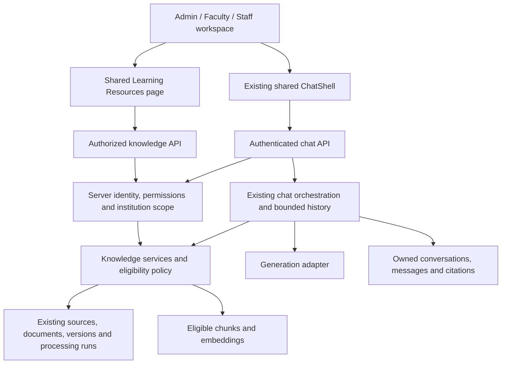

# Shared resources and chat: application architecture

Proposed architecture. [README](README.md) separates this plan from existing code.

## Reuse the current application

Keep React/TypeScript, feature hooks, TanStack Query, the existing service clients,
FastAPI layers and the document/retrieval pipeline. This design does not require
a new agent framework, a second resource store or separate role chat services.

## Data ownership and eligibility

Reuse `knowledge_sources -> documents -> document_versions -> processing_runs`
and the existing chunk/embedding records. FAQs and notices retain their canonical
tables and existing synchronization into the retrieval pipeline. Presentation
adapters must not create a second editable copy of that text.

Treat these as independent dimensions:

- **Processing:** uploaded/queued, extracting/chunking/embedding, indexed or failed.
  UI labels are derived from actual processing and embedding fields; the current
  processing-run `ready` value alone does not establish complete AI readiness.
- **Publication:** existing source/version lifecycle and effective dates.
- **Audience:** existing `public`, `authenticated` and `restricted` visibility.
- **Action capability:** server-authorized read, create, edit, version and
  publication actions within an active institution grant.

The target reader/RAG predicate is: correct institution, authorized audience,
published and effective source/version, valid processing provenance and completed
embeddings. Management reads may expose authorized drafts without making them
retrievable. Metadata-only sources can be listed with AI unavailable.

Centralize the authenticated eligibility policy under `services/knowledge/` and
apply its criteria to repository retrieval before ranking/limiting results,
resource detail, citations and file delivery. Reuse date/provenance helpers
where appropriate; preserve the stricter anonymous public-knowledge policy.
Do not describe the existing general authenticated vector search as already
enforcing this complete predicate.

For the first shared reader projection, allow eligible public/authenticated
sources in the caller's institution with the required read grant. Restricted
sources remain denied unless an existing explicit access rule can authorize
them; confirm that rule before supporting restricted reader access. Source
creation must retain the current restricted default unless an authorized actor
explicitly chooses another supported audience.

An admin's ability to manage a draft does not authorize the ordinary assistant
to answer from it. A future editor preview would need a separate explicit,
audited contract. Personal academic records remain outside the chat service.

## Permission contract

Runtime grants and role/scope dependencies must both pass. Reference defaults do
not prove an endpoint is usable: current admin CRUD handlers require admin scope,
even when faculty/staff have similarly named permissions.

| Operation                            | Proposed enforcement using existing permission names                                                                                |
| ------------------------------------ | ----------------------------------------------------------------------------------------------------------------------------------- |
| Read shared library metadata/details | Active admin/faculty/staff institution scope plus `documents.read`; filter every record by reader/management policy.                |
| Create a source or ingest content    | Exact scoped role plus `ai.knowledge.create`; preserve additional document-create requirements for the chosen upload operation.     |
| Upload a document/version            | `documents.create` / `documents.update` respectively, plus knowledge-create when executing indexing; check source/version ancestry. |
| Edit source metadata/publication     | `ai.knowledge.update` and existing scoped management policy; no new faculty/staff grant is inferred.                                |
| Delete documents                     | `documents.delete` plus the existing management policy.                                                                             |
| Chat or ask about a source           | `ai.chat` plus eligibility of every retrieved source; a resource selector never grants access.                                      |
| FAQ editorial operations             | Preserve existing knowledge permissions and admin scope until explicitly migrated.                                                  |

The shared `documents.read` projection exposes only reader-safe metadata.
Management fields and draft/restricted management listings additionally require
`ai.knowledge.read` and the existing management scope. The new reader API must
not inherit the broader payload of an admin endpoint.

Return operation-specific capabilities from the server, for example `canUpload`,
`canAddVersion`, `canEditMetadata`, `canPublish`, `canRetryIndexing`, `canDelete`
and `canAskAi`. They describe exact allowed operations on that record, including
state constraints. The frontend uses them for presentation; endpoints recheck.
Do not use a generic edit flag to imply publication or upload permission.

## Proposed API surface

These routes do not exist as a shared facade today. Keep `/api/v1/admin/*`,
`/api/v1/documents/*`, `/api/v1/students/me/resources` and current chat/history
contracts compatible while introducing focused endpoints under the knowledge
feature. Document every new method/path in the appropriate permission policy.

| Proposed route under `/api/v1`                     | Responsibility                                                                                         |
| -------------------------------------------------- | ------------------------------------------------------------------------------------------------------ |
| `GET /knowledge/resources`                         | Safe scoped list, supported search/type/status filters, bounded pagination and operation capabilities. |
| `GET /knowledge/resources/{source_id}`             | Authorized source metadata and permitted document/version summaries.                                   |
| `POST /knowledge/resources`                        | Source creation with server-owned tenant/actor and constrained editable fields.                        |
| `POST /knowledge/resources/{source_id}/documents`  | Shared upload facade reusing existing ingestion/orchestration.                                         |
| `POST /knowledge/documents/{document_id}/versions` | Scoped new-version operation preserving the current version rules.                                     |
| `PATCH /knowledge/resources/{source_id}`           | Authorized metadata/publication changes with state validation.                                         |

Add status/retry/file-delivery endpoints only when their underlying service and
policy support them. Ordinary responses omit storage paths, extracted content,
raw processor errors and credentials. List responses declare pagination/total
semantics; a returned page length is never presented as a global total.
Readiness and capability fields must come from persisted state, not client timers.

Extend `AuthenticatedChatRequest` only in the resource-context phase. Today it
forbids extra fields and does not accept retrieval filters. A proposed optional
resource context must be validated server-side, resolved through its institution
and persisted on the owned conversation. Reject context mismatches. Never expose
internal chunks, prompt controls or provider/model selection as browser input.
Keep the existing required institution field compatible while using `/auth/me`
identity in the client; the server continues to check it against active scope.

## Layer placement

| Layer                                       | Ownership                                                                                               |
| ------------------------------------------- | ------------------------------------------------------------------------------------------------------- |
| Shared frontend feature                     | `features/learning-resources/`; shell composition only in role features.                                |
| Frontend transport                          | Proposed `services/knowledge/` domain; update the services guide when introduced.                       |
| Frontend contracts                          | Reuse admin/student types where accurate; add focused knowledge contracts only for new responses.       |
| Knowledge API/services/repositories/schemas | `backend/app/{api,services,repositories,schemas}/knowledge/`; add focused modules to existing packages. |
| Chat orchestration                          | Existing `services/ai/chat.py` and `chat_support/`; retain generation/history adapters.                 |
| Database changes                            | `supabase/migrations/` and maintained migration sources, only for demonstrated contract gaps.           |

Move reusable orchestration out of admin ownership into knowledge services as
needed, updating all callers and tests together. Keep admin wrappers for their
existing contracts; do not make knowledge services depend on admin routes.
Inspect destination file counts before implementing; split by workflow within
the 15-file/250-line limits. This draft creates no runtime modules or schema.

## Server state, identity and reliability

Use domain query keys scoped by auth generation, user, institution, grants and
normalized request filters according to the existing server-state guide. Keep
access tokens out of keys. Query options own reads; hooks own guarded mutations;
components own rendering and local interaction state.

Invalidate the affected scoped resource lists, exact detail and related document
status after writes. Invalidate only the affected conversation/message keys
after chat. Publication changes affect resource availability; always recheck it
on the server rather than relying on a cached client badge.

On logout, account/tenant/grant replacement, cancel/remove retired private queries
and reset local chat/resource context. Every late read/mutation callback checks
the captured identity before changing state or caches. Token renewal retains the
existing session-generation behavior.

Preserve drafts after errors, prevent duplicate submits and use version/conflict
checks for publication or replacement. Automatic retries of writes require an
explicit idempotency contract. Start by reusing the current synchronous pipeline;
if durable jobs are introduced, add persisted stage/retry state and a worker
before offering background completion or detailed live progress in the UI.

History restoration must verify ownership and current source eligibility. Decide
how to redact previously persisted answers/citations after access revocation
before enabling resource-scoped history; simply hiding the source card is
insufficient. Keep telemetry content-free and separate from user-visible errors.
