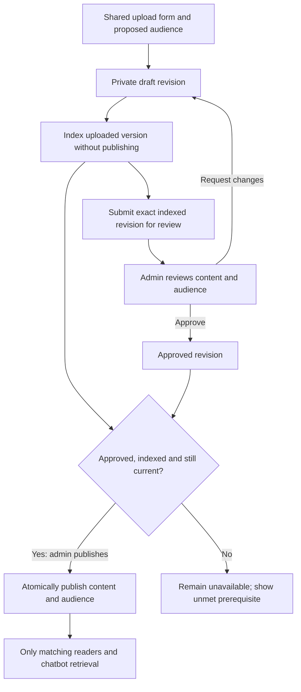

# Audience-based resource upload and publication

Design and staged implementation, 28 October 2026. This extends the
[shared design](README.md). The [database model](DATABASE_MODEL.md) is implemented
with prepared migrations and disposable checks. Shared upload/review UI and APIs,
audience-aware chat and [resource-specific Ask AI](RESOURCE_CHAT.md) are implemented.

Confirmed decision: **admins publish and change the live audience; faculty and
staff submit drafts for admin review**. All three use the same upload component.
Teacher is the product synonym for the existing backend `faculty` role.

## Audience choices and answer access

| Upload audience                    | Visitor | Student | Staff | Faculty / teacher | Admin reader |
| ---------------------------------- | ------- | ------- | ----- | ----------------- | ------------ |
| Public                             | Yes     | Yes     | Yes   | Yes               | Yes          |
| All signed-in institution members  | No      | Yes     | Yes   | Yes               | Yes          |
| Students only                      | No      | Yes     | No    | No                | No           |
| Staff only                         | No      | No      | Yes   | No                | No           |
| Faculty / teachers only            | No      | No      | No    | Yes               | No           |
| Selected roles: Students + Faculty | No      | Yes     | No    | Yes               | No           |
| Administrators only                | No      | No      | No    | No                | Yes          |

These are audience matches, not unconditional permission grants. Every answer
also requires published/effective content and successful indexing. Private chat
still requires `ai.chat`; library reads require their separate read capability.
Signed-in membership must be active and approved where the role requires approval.

Public means any visitor can ask the public chatbot for the resource's
institution without signing in. It also remains usable by that institution's
signed-in readers. Public does not merge every institution's knowledge into one
chat. A different institution's member can use this institution's public entry,
but their authenticated chat remains scoped to their own institution.

Selected roles combine with **OR**: Students + Faculty means either matching
role. Roles come from verified active grants in that same institution, never a
browser selection or prompt. Preserve current fail-closed scope resolution;
ambiguous institution grants are not combined. Exact operation permissions
remain tied to their matching role and institution provenance.

An admin can review/manage content using explicit management access. That does
not add Admin to a Students-only audience or authorize ordinary admin chat to
answer from it. No subject/class/batch/individual targeting is included in v1;
those require their own authoritative membership relationships later.

## One shared upload form

```text
Add learning resource

Title*              [Student scholarship guide................]
Description         [.........................................]
Resource type*      [Existing supported type v]
File*               [Choose file]

Who can the AI answer using this resource?
( ) Public - anyone visiting this institution's chatbot
( ) All signed-in institution members
(x) Selected roles
    [x] Students  [ ] Staff  [x] Faculty / teachers  [ ] Admins

Audience: Students and faculty in your institution
Availability: after indexing and admin publication

[Save draft]                                  [Submit for review]
```

The initial draft is private and is never preselected Public. Uploaders propose
an audience; admins confirm or change it during review. Selecting Public shows
plain inline text: "Visitors can receive answers based on this resource."
Public answer access does not automatically enable a file-download link.

Use the same form, detail drawer, audience badges and server-reported indexing
states in every role. Admin capabilities add Review, Request changes, Publish,
Unpublish and Change audience. Faculty/staff can view and edit their own allowed
drafts, submit them, and read reviewer feedback; no live publication control is
present. Owning a draft never authorizes chat to answer from it.

The admin review view shows uploader, requested audience, file/version manifest,
indexing state, effective dates, changes from the live revision and feedback.
**Publish** names the audience and publishes exactly the reviewed revision.
The implemented first version requires complete metadata/audience and successful
indexing before submission. A failed index stays in draft with an authorized retry.

## Draft, review and publication



Use existing lifecycle vocabulary on revisions: `draft`, `under_review`,
`approved`, `published`, `archived`, `superseded`. Request changes returns a
submission to draft with recorded feedback. Editing approved content invalidates
approval. Admins can review/publish their own uploads with the same validation.

For an already published source, a new upload or proposed audience change creates
a new revision. The current published revision remains authoritative while the
proposal is reviewed. Neither creation nor indexing supersedes it. Publication
switches the approved version manifest and audience in one transaction. Admin
Unpublish/Archive can remove access immediately without waiting for review.

Each resource has one audience inherited by its documents/versions. Files with
different audiences must be separate resources. Adding a file to a live resource
is also a revision requiring approval, not an immediate live attachment.

## Proposed data and API contracts

Keep `knowledge_sources`, documents, versions, processing runs and embeddings.
Retain the `visibility` vocabulary: Public maps to `public`, all signed-in maps
to `authenticated`, and selected roles maps to `restricted` plus explicit roles.
Empty/malformed selected roles never authorize readers.

Add focused review/provenance records rather than a second content pipeline:

| Proposed record                                                | Responsibility                                                                                                                |
| -------------------------------------------------------------- | ----------------------------------------------------------------------------------------------------------------------------- |
| `knowledge_source_revisions`                                   | Source FK, revision number, proposed metadata/visibility/effective dates, lifecycle, uploader/reviewer and concurrency token. |
| `knowledge_source_revision_audiences`                          | Revision FK plus canonical role (`student`, `staff`, `faculty`, `admin`); unique revision/role pairs.                         |
| `knowledge_source_revision_documents`                          | Revision FK and exact document/version manifest; enforce source/tenant ancestry.                                              |
| `knowledge_sources.published_revision_id` and `policy_version` | Pointer to that source's live revision and policy concurrency version; live metadata/visibility update atomically from it.    |

Foreign keys, constraints and publication transactions enforce valid roles,
nonempty selected targets, source/revision ownership and valid version ancestry.
Draft/review creation never updates live audience fields. Published revision
content is immutable; publication/review/audience decisions append audit events.

The shared draft API accepts `audience.mode` (`public`, `institution`, `roles`)
and `audience.roles` (nonempty only for `roles`). Reject invalid combinations
and unknown roles. Tenant, owner, approval and live status are server-owned.

Extend the proposed knowledge facade with revision detail, submit-for-review,
request-changes, publish and unpublish operations. Publication receives the exact
revision ID and expected revision/source-policy tokens; stale review returns a
conflict. Do not allow generic metadata PATCH, ingestion, embedding or old version
routes to bypass review or mutate published content/audience. URL compatibility
cannot promise unchanged publication behavior under the new review rule.

Admin publication requires active institution-admin scope and the existing
`ai.knowledge.update` grant, with document/source action grants rechecked as
needed. No publishing grant is added to faculty/staff. Own-draft read/edit/submit
needs an explicit ownership-and-permission policy; source-level read grants alone
must not expose other uploaders' drafts.

## Retrieval, history and migration

Compute eligible sources before vector ranking and result limits:

```text
correct institution AND published revision AND effective source/version
AND version belongs to the approved manifest AND ready/embedded provenance
AND (public OR verified institution member for authenticated visibility
     OR verified same-institution role matches selected roles)
```

Anonymous retrieval always uses only the Public branch. Apply the same audience
predicate to library metadata/details, citations, history context and any future
file delivery. A question saying "I am staff" cannot change verified access.
Exclude inaccessible titles, snippets and counts as well as document text.

Recheck policy before response delivery. History restoration and follow-up
rewriting must remove turns derived from sources the user can no longer access,
including inherited provenance from earlier answers. Audience changes invalidate
affected caches and future access; already disclosed public answers cannot be
recalled from a visitor. Unpublish does not depend on deleting embeddings first.

Backfill existing eligible public/authenticated sources into published revisions
without broadening access; create manifests from their existing eligible
versions. Existing restricted sources with no explicit audience remain denied.
Do not infer targets from filename, source type, uploader role or document text.
Policy changes need no re-embedding when content is unchanged.

Authenticated chat and the student metadata query now use the shared audience
predicate; student response shape and FAQ/notice exclusions are preserved. Public
retrieval retains Public/lifecycle/indexing checks and requires the live manifest
for revision-managed sources. The [implemented API](API.md) documents review,
concurrency and history behavior. Canonical FAQ/notice synchronization
deliberately creates public sources today; preserve that explicit workflow and
prevent uploads from inheriting it accidentally. Keep canonical-only types out
of the file-upload type selector.

## Delivery order and acceptance

1. Add revision/audience schema, conservative backfill and atomic admin-only
   publication; close every existing write path that could bypass review.
2. Add one policy for reader APIs, authenticated retrieval, public retrieval and
   student metadata; verify filtering before enabling role-restricted publication.
3. Build the shared uploader, own-draft views, admin review and audience badges.
4. Connect chat/citations/history and invalidate scope/policy-dependent caches.
5. Validate end to end, then enable publication with the complete policy deployed.

Acceptance cases include every audience-matrix cell; combined roles; inactive or
unapproved membership; two institutions; attempted staff/faculty publication;
private draft indexing; empty/forged audience; new-version review; stale admin
approval; publish/retry races; audience narrowing; in-flight responses; old chat
history and follow-up questions. Include real API/SQL policy tests, not only UI
visibility checks.
