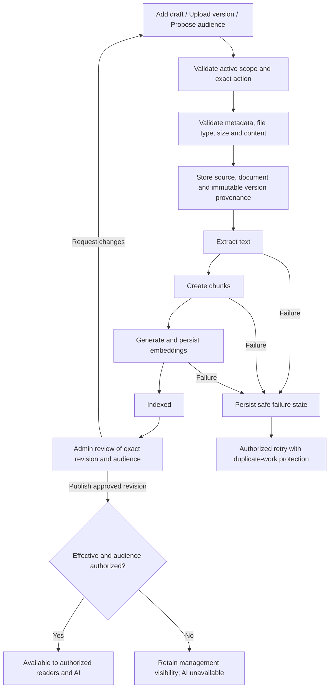
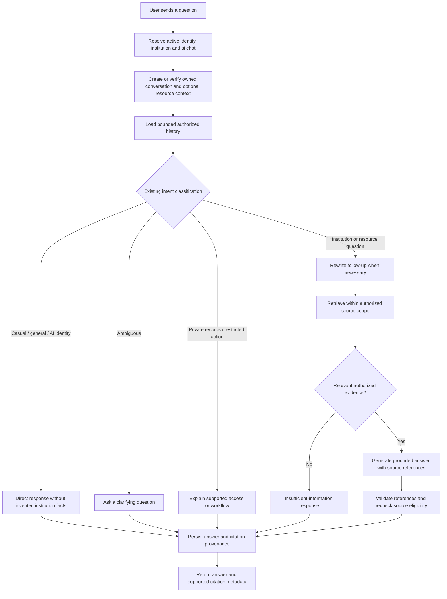

# Resource and AI chatbot workflows

Proposed workflows for the [shared design](README.md). Existing pipeline stages
and chat intent handling are reused; missing contracts are delivery work below.

The [audience-based upload plan](AUDIENCE_UPLOAD.md) is the detailed contract:
Public permits visitor answers; Students/Staff/Faculty-only audiences require a
verified matching institution role. Faculty/staff submit drafts and proposed
audiences; admins alone publish and change the live audience.

## Resource ingestion and availability

1. A user with the exact create/upload capability enters metadata, a proposed
   audience and a file for a permitted draft. The server derives institution and
   actor from identity. Upload, indexing and review remain separate states.
2. Validate before storing. Reuse supported ingestion constraints and the
   existing cleanup behavior for failed registration/storage operations.
3. Run the existing extraction, chunking and embedding services. A successful
   upload alone does not mean the resource can answer questions.
4. Show separate indexing, publication and audience values. A failure identifies
   the failed stage without exposing raw provider/storage/database details.
5. Admin publication validates the exact approved revision, audience, version
   manifest and effective dates, checks institution-admin scope and exact grants,
   and records an audit event. Generic PATCH/ingest must not bypass review.
6. New versions stay in draft while the current published revision serves
   answers. Stage them without early supersession, then atomically switch
   manifest and audience after review/indexing. This intentionally replaces the
   current early-supersession path for the shared review workflow.
7. Unpublish/archive/delete removes content from future retrieval and permitted
   delivery. Recheck in-flight source eligibility before releasing an answer.

FAQs remain canonical records. Their existing publication synchronization feeds
the document pipeline; the shared resource list is a projection of that data,
not an alternative FAQ editor or independent text store.

## Authenticated chatbot

This flow now includes audience-policy enforcement and immutable resource
context. Intent classification, rewriting, retrieval, generation and synchronous
message/policy persistence reuse the existing pipeline. See [Ask AI](RESOURCE_CHAT.md).

The selected institution comes from the authenticated frontend identity and is
checked against server scope; no fixed demo institution remains in `useChat`.
No request can choose an unrelated institution or another user's chat.

For a resource question, enforce the selected resource scope across follow-ups
and history. For institution questions, search only currently eligible sources
in that institution matching Public, all signed-in, or their selected-role
audience. Filter before vector ranking/limits. Retrieved text is evidence,
never permission to execute a
document's instructions or modify account/academic data.

An absent or irrelevant match yields an honest limitation. Provider/retrieval
failure yields a retryable error, distinct from no evidence. Signed-in chat uses
the implemented [turn recovery contract](CHAT_RECOVERY.md) before explicit retry
after an uncertain timeout.

Keyed turns save answer/retrieval/citation records atomically. History restores
source cards after owner, current-policy and exact retrieval checks; missing legacy
citations remain empty. Unkeyed legacy requests retain background persistence.
Trace technical events without logging raw prompts or document contents by default.

## Public chatbot boundary

Keep anonymous chat separate: resolve a public institution code, apply existing
rate/concurrency controls, and answer institution questions only from currently
authorized public knowledge. It remains stateless at the API boundary. Shared
visual primitives do not make authenticated resources or conversation history
available anonymously.

Public requests have a full-response deadline and a Stop waiting control. Failed
questions remain in college-scoped browser history, including after reload.
Explicit retry reuses the displayed question, respects server Retry-After delays
and never runs automatically. Stale callbacks cannot update another college or
replace a newer reply. Public retries do not use authenticated turn receipts.

## Delivery sequence and acceptance

| Stage                         | Concrete result                                                                          | Required evidence                                                                                                                  |
| ----------------------------- | ---------------------------------------------------------------------------------------- | ---------------------------------------------------------------------------------------------------------------------------------- |
| 1. Audience schema and policy | Revision manifests, role targets, admin-only publication, shared reader/retrieval policy | Every audience matrix cell; publication bypass prevention; student metadata filtering; conservative migration.                     |
| 2. Shared library UI          | Admin/faculty/staff mount the same page and detail components                            | Same layout and actions for equal capabilities; differing grants affect only allowed data/actions; responsive and keyboard review. |
| 3. Shared management          | Shared upload/version drafts, audience proposal and admin review                         | Own-draft access; admin-only publication; draft retention; indexing failures; stale approvals; atomic replacement.                 |
| 4. Chat integration           | Authenticated institution context; common retrieval eligibility                          | No fixed institution; irrelevant evidence response; general/casual path; private-record and action boundaries.                     |
| 5. Resource context           | Authorized Ask AI and persisted source-scoped conversations                              | Scope tampering denied; follow-ups stay scoped; owned history restores safely; revoked data is redacted.                           |
| 6. Operational hardening      | Implemented signed-in status recovery, explicit retry and atomic answer/citation persistence; see [contract](CHAT_RECOVERY.md) | Lost-response replay, expired worker fencing, retry after reload, revocation and no duplicate saved turns. |

Every stage preserves existing tenant isolation and compatible routes until its
consumers migrate. Add no optimistic publication, invented progress, sample
records, unimplemented download button or unsupported backend filter.

Regression coverage should exercise shared components rather than three copied
test suites. Include server API policy tests and meaningful integration checks
for creation, processing, publication, retrieval and citations. Test logout,
replacement identity, grant changes, renewal and late callbacks across reads and
writes. Student metadata-only resources and public chat remain regression cases.
Keep new audience publication disabled until reader/retrieval/history enforcement
and end-to-end checks are deployed together.

At implementation time, run frontend structure/build/tests and backend structure
plus affected regression tests. Review direct file counts and physical line
counts separately; keep verification output in `logs/frontend/` or
`logs/backend/`. The shared UI and APIs now follow these flows; retain document,
structure and regression checks. Deployment verification remains a separate
environment-specific step.
