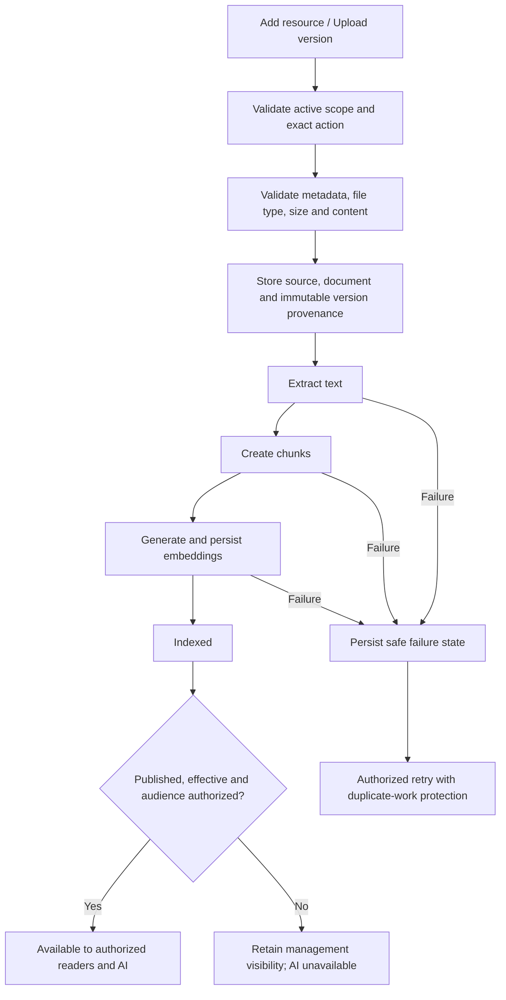
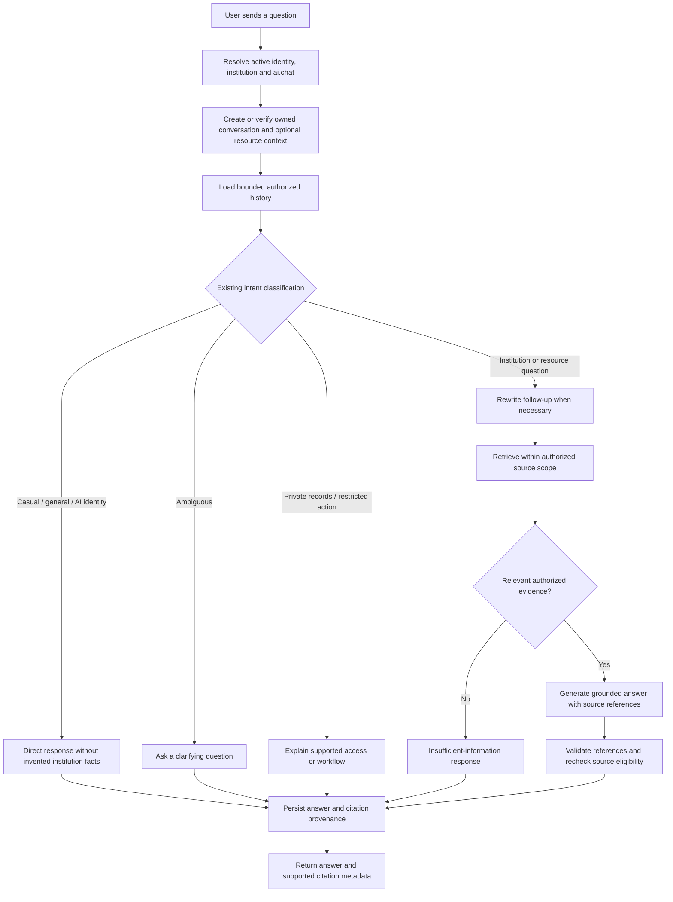

# Resource and AI chatbot workflows

Proposed workflows for the [shared design](README.md). Existing pipeline stages
and chat intent handling are reused; missing contracts are delivery work below.

## Resource ingestion and availability

1. A user with the exact create/upload capability enters metadata or selects an
   authorized source. The server derives institution and actor from identity.
2. Validate before storing. Reuse supported ingestion constraints and the
   existing cleanup behavior for failed registration/storage operations.
3. Run the existing extraction, chunking and embedding services. A successful
   upload alone does not mean the resource can answer questions.
4. Show separate indexing, publication and audience values. A failure identifies
   the failed stage without exposing raw provider/storage/database details.
5. Publication validates the source/version and effective dates, checks the
   existing management grant, and records an audit event. This is a proposed
   state-validating workflow, not an assumption about today's generic PATCH.
6. New versions preserve provenance and the current supersession behavior.
   Define a replacement transition before implementation: no partly indexed
   version can become retrievable. Retaining the old version while indexing a
   replacement requires a separately tested atomic switch if current behavior
   would otherwise remove it earlier.
7. Unpublish/archive/delete removes content from future retrieval and permitted
   delivery. Recheck in-flight source eligibility before releasing an answer.

FAQs remain canonical records. Their existing publication synchronization feeds
the document pipeline; the shared resource list is a projection of that data,
not an alternative FAQ editor or independent text store.

## Authenticated chatbot

Treat this as the target flow. Existing code already classifies intents, rewrites
queries, retrieves chunks, generates answers and persists messages; complete
reader-policy enforcement and resource context remain implementation work.

The selected institution comes from the authenticated frontend identity and is
checked against server scope. The current fixed demo ID in `useChat` must be
removed. No request can choose an unrelated institution or another user's chat.

For a resource question, enforce the selected resource scope across follow-ups
and history. For institution questions, search only currently eligible sources
in that institution. Retrieved text is evidence, never permission to execute a
document's instructions or modify account/academic data.

An absent or irrelevant match yields an honest limitation. Provider/retrieval
failure yields a retryable error, distinct from no evidence. Do not retry a
possibly persisted user turn blindly: define a client-turn idempotency/recovery
contract before introducing one-click resend after an uncertain timeout.

Keep source/version/chunk provenance tied to the answer. Current auxiliary
response/citation persistence uses a background thread; dependable restoration
requires a durable strategy or transaction/outbox design before guaranteeing
complete citation history. Trace technical events without logging raw prompts
or document contents by default.

## Public chatbot boundary

Keep anonymous chat separate: resolve a public institution code, apply existing
rate/concurrency controls, and answer institution questions only from currently
authorized public knowledge. It remains stateless at the API boundary. Shared
visual primitives do not make authenticated resources or conversation history
available anonymously.

## Delivery sequence and acceptance

| Stage                       | Concrete result                                                           | Required evidence                                                                                                                  |
| --------------------------- | ------------------------------------------------------------------------- | ---------------------------------------------------------------------------------------------------------------------------------- |
| 1. Read policy and contract | Shared metadata/detail facade; precise capabilities and eligibility rules | Same-tenant allowed reads; cross-tenant denial; restricted/draft filtering; pagination semantics.                                  |
| 2. Shared library UI        | Admin/faculty/staff mount the same page and detail components             | Same layout and actions for equal capabilities; differing grants affect only allowed data/actions; responsive and keyboard review. |
| 3. Shared management        | Supported source/upload/version actions use shared hooks and services     | Exact action permissions; retained drafts; stage failures; duplicate submits; preserved admin/FAQ contracts.                       |
| 4. Chat integration         | Authenticated institution context; common retrieval eligibility           | No fixed institution; irrelevant evidence response; general/casual path; private-record and action boundaries.                     |
| 5. Resource context         | Authorized Ask AI and persisted source-scoped conversations               | Scope tampering denied; follow-ups stay scoped; owned history restores safely; revoked data is redacted.                           |
| 6. Operational hardening    | Reliable retry/status and answer/citation persistence as needed           | Crash/timeout recovery, version transitions, in-flight revocation and no duplicate turns.                                          |

Every stage preserves existing tenant isolation and compatible routes until its
consumers migrate. Add no optimistic publication, invented progress, sample
records, unimplemented download button or unsupported backend filter.

Regression coverage should exercise shared components rather than three copied
test suites. Include server API policy tests and meaningful integration checks
for creation, processing, publication, retrieval and citations. Test logout,
replacement identity, grant changes, renewal and late callbacks across reads and
writes. Student metadata-only resources and public chat remain regression cases.

At implementation time, run frontend structure/build/tests and backend structure
plus affected regression tests. Review direct file counts and physical line
counts separately; keep verification output in `logs/frontend/` or
`logs/backend/`. This design-only change requires document/link and structure
checks; it does not certify runtime or deployed behavior.
