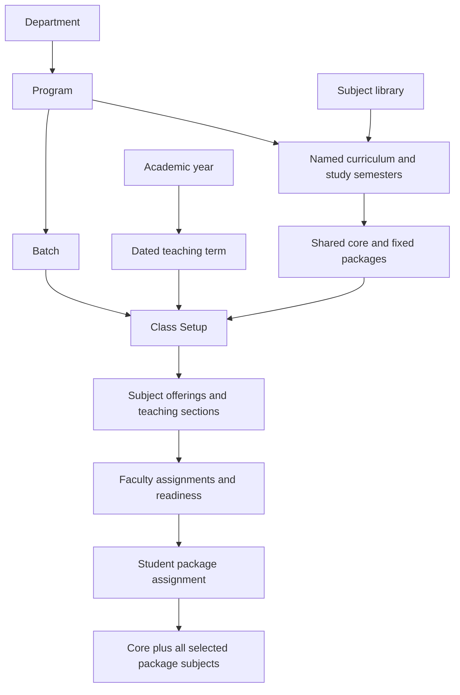

# Academic Setup: curricula, subject packages, and class setup

Prepared: 2026-10-21 (Asia/Calcutta).

Status: unified workflow implemented and validated locally; the academic schema
is installed and Quest's authorized academic fresh start is complete. See
[Implementation and validation](implementation.md) for release evidence. The
audit remains a historical preimplementation baseline.

## Reading order

1. This document: terminology, examples, setup order, and screen organization.
2. [Assignment rules](assignment-rules.md): selection, permissions, requests,
   cutoff enforcement, and academic history.
3. [Implementation plan](implementation-plan.md): current architecture, proposed
   integration, delivery stages, acceptance checks, and open decisions.
4. [Implementation and validation](implementation.md): delivered schema, APIs,
   policy decisions, migration preparation, and verification evidence.
5. [Preimplementation audit](audit/README.md): source-based normalization,
   duplication, security/RBAC, integrity findings, and remaining live evidence.

The [Academic Setup guide](../../ACADEMIC_SETUP.md) describes the unified
administrator workflow. Database entities remain implementation details;
administrators follow the six stages below.

## Goal and agreed behavior

Students in the same course/branch, batch, academic year, semester, and class
section can study different fixed subject packages while sharing core subjects.

- A curriculum is a named collection of multiple subjects.
- Packages contain complete subject combinations; choosing one assigns every
  subject in that package together with the curriculum's shared core subjects.
- Admin controls whether students may choose their initial package themselves.
  Otherwise, authorized administration assigns it.
- After assignment, students can request a change. Only authorized administration
  can apply a change, including an approved student request.
- Package changes close at a class/semester cutoff. Once the class has progressed
  too far, such as halfway through its semester, changes are blocked for everyone.
- The Academic Setup sequence should support this model while retaining the
  existing dark panels, yellow accents, searchable directories, and detail panes.

## Example

One class shares a course/branch, batch, teaching period, study semester, and
section. Its curriculum includes required core subjects DSA and ML.

| Selection code | Shared core | Package subjects | Effective assigned subjects |
| --- | --- | --- | --- |
| `CSE202-DEEBS` | DSA, ML | A, B, C | DSA, ML, A, B, C |
| `CSE202-ABCD` | DSA, ML | E, F, G | DSA, ML, E, F, G |

A through G are subject placeholders, not section names. Students choosing
different packages stay in the same class. They share the DSA and ML teaching
groups and join the appropriate additional subject groups.

Packages reference existing subjects. Shared core subjects and their memberships
must not be duplicated for each package. Students cannot select only part of a
package or combine parts of these two packages.

## Terminology and ownership

| Concept | Meaning |
| --- | --- |
| Department | Academic department responsible for programs or subjects. |
| Course / branch / program | The degree and branch being studied, such as B.Tech Computer Science. Current source calls this a `program`. |
| Batch | Admission cohort, such as 2026-2030; distinct from an academic year. |
| Academic year | A dated institutional academic period. |
| Teaching term | A dated semester within an academic year; current source uses `semester_id` for this. |
| Study semester | The stage in the degree, such as Semester 5 of eight. The class connects it to a dated teaching term. |
| Subject | A reusable subject definition, such as DSA. Current source calls this a `course`. |
| Curriculum | A named study plan with a code, subjects, study-semester organization, and classifications. |
| Subject package | A fixed selectable subject group; packages belong to a curriculum study semester. |
| Class setup | The shared course/branch, batch, year, term, study semester, section, and curriculum context. |
| Subject offering | An occurrence of a subject taught in a particular academic context. |
| Teaching section | The subject-specific teaching group used by faculty, rosters, attendance, and results. |
| Package assignment | A student's selected package in a class/term, with the resulting subject memberships. |

Use explicit labels in the UI so degree courses and individual subjects remain
easy to distinguish. Whether course and branch need separate master records is
outside this version; the existing program record combines them.

## Subject classifications

The curriculum determines whether a subject is core, elective, open elective,
skill, or project. A subject can be core in one program and elective in another.

The existing curriculum link already supports these classifications. The Subject
screen should make classification discoverable in its curriculum context. A
subject-level default type is a possible convenience, not an agreed global rule.

For the agreed package model, shared core subjects are required. Every subject
inside the selected package is also assigned; the word "elective" describes the
curriculum choice and does not permit partial assignment of that package.

## Target setup sequence

| Step | Screen / stage | Result |
| --- | --- | --- |
| 1 | College basics | Departments, degree programs/branches, and admission batches. |
| 2 | Calendar | Academic years and dated teaching terms. |
| 3 | Subjects | Reusable subject definitions owned by departments. |
| 4 | Curricula & packages | Named/versioned plans, study semesters, classifications, shared core, and complete packages. |
| 5 | Classes | Batch, dated term, study semester, section, curriculum, enabled packages, rules, and prepared teaching groups. |
| 6 | Assignments | Class placements, complete package assignment, change requests, and history. |

Department/program/batch setup and calendar setup can be prepared independently.
Dependencies should guide the administrator without requiring unrelated records
to be re-entered. Classes must have valid subjects and teaching groups before
their packages become available for assignment.

## Screen organization

Academic Setup has one six-stage navigation. College basics and Calendar contain
their relevant directories and forms. The former nine-entity navigation and
standalone legacy Program Curriculum screen are removed from this workflow.

Curricula & packages contains the named plans, core subjects, classifications,
and package membership. Classes contains available packages, rules, and subject
teaching groups. **Prepare teaching groups** creates or reuses each required
offering and class section and maps them together in one transaction. Existing
valid mappings are retained; an invalid mapping stops the operation completely.
Offerings and teaching sections are managed within this class context.

Assignments contains placement, package selection, change requests, and history.
Student Management and authorized staff/faculty/student workspaces can expose
the same operational components without duplicating curriculum configuration.
Faculty teaching assignment continues in Faculty Assignments.

Keep the existing visual direction and responsive directory/detail pattern.
Provide subject previews, clear prerequisites, permission-aware actions, and
honest empty states. Do not display planned features as working until their
backend behavior exists.

## Names, codes, and identity

A curriculum needs an administrator-readable name and code; `CSE-202-DSEE` is
an example curriculum code from the discussion. A package also needs a clear
name, such as "Package ABC", and a readable selection code.

Keep stable internal identifiers for the program, curriculum, package, class,
offering, and student assignment. Give the class an identifiable code and each
offered package a selection code referencing that class context. Selecting a
code must show the program, batch, year/term, study semester, section, and full
subject list before confirmation.

The example codes above are illustrative. Generated class codes use program,
batch admission year, study semester, section, and a stable UUID suffix; the
selection code appends the package code. Class identity and published curriculum
contents are immutable. Do not infer a batch,
semester, or year from `202` or replace relationship records with parsed codes.

## Scope of this documentation

This package records the agreed workflow, its implementation, and the original
audit. See [Implementation and validation](implementation.md) for the current
code, settled policy, verification evidence, and release status. The authorized
[fresh-start scope](fresh-start.md) is limited to Quest's academic records;
accounts, roles, other institutions, and other modules are preserved.
