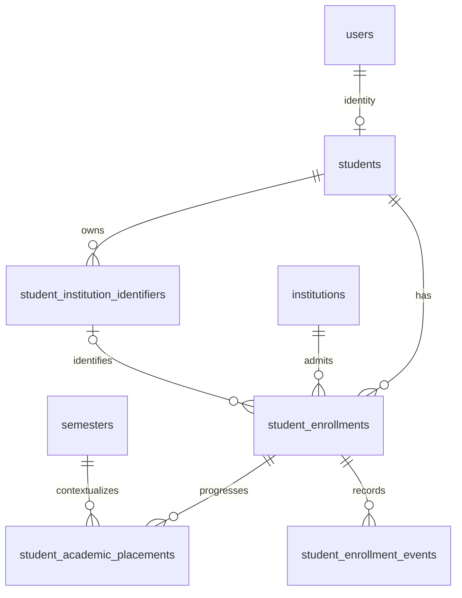

# Student enrollment schema final review

Prepared 2026-10-11, Asia/Calcutta. Recommendation, not installed state. Read with [ADR-003](ADR-ENROLLMENT-003.md) and [candidate SQL](student_enrollment_schema_review_draft.sql).

## Evidence boundary

Current repository evidence is the current migration/source bytes, recorded in `SOURCE_EVIDENCE.json`. Earlier local observations in the root M1 and security reports are historical findings, not independently verified catalog facts today. All 39 migration filenames are present; the highest is `20261016010000`, despite today's date. File presence and earlier ledger membership do not prove applied-byte equality or any remote state.

The archive contains 14 files and **no SQL entries**. Its three enrollment Markdown documents were read from `docs/evidence/patch_reviews/college_ai_enrollment_review_patch_v2/source/docs/{architecture,design,validation}/`. Original top-level `docs/architecture/ADR-ENROLLMENT-002.md`, `docs/design/STUDENT_ENROLLMENT_SCHEMA_V2.md` and `docs/validation/STUDENT_ENROLLMENT_VALIDATION_PLAN_V2.md` are absent. Their archived contents are recovered evidence. No earlier enrollment SQL draft was recovered from the repository or archive; this package supplies a new draft. Embedded security SQL in `SECURITY_REMEDIATION_PLANNING_REPORT.md` was inspected as historical proposal text and is not adopted automatically.

## Verified existing contracts

| Repository definition | Implication |
| --- | --- |
| Admin-1 migration: `students` PK `student_id`, UNIQUE `user_id`, FK `user_id -> users.id ON DELETE CASCADE` | Preserve identities. `users.auth_user_id -> auth.users.id` is a separate key; `auth.uid()` is not `students.user_id`. New restrictive history FKs will block cascading identity deletion once history exists. |
| Identity migration: nullable register/roll/email; approval pending/approved/rejected; status active/inactive/graduated/withdrawn | Account approval and academic lifecycle already differ. `is_active` is a separate archive flag. |
| Student institution and enrollment_date/student_number are required; program/year nullable; identifier UNIQUE by institution | During compatibility identity insert still requires legacy fields. They cannot express multiple episodes. Registration derives student_number from register/roll and often sets enrollment_date to today. That is not proof of a distinct issuer-issued number or historical admission. |
| `programs -> departments -> institutions`; `academic_years.institution_id`; `semesters.academic_year_id` | Verify ancestry, not just FK existence. Baseline already has UNIQUE `(semester_id,academic_year_id)`; reuse it. |
| `sections -> course_offerings`; offerings reference course/program/year/semester | No generic class section on student identity. A placement cannot imply membership of every subject. |
| Attendance UNIQUE `(student_id,section_id,date)`; consolidated result UNIQUE `(student_id,academic_year_id,semester_id,program_id)` | Result uniqueness cannot distinguish repeats/supplementary publications in the same context. Attendance key can remain if the real session is the deduplication unit. |
| Workflow result UNIQUE `(test_id,roster_id)` and partial `(test_id,student_id)`; legacy partial `(student_id,course_id,test_name,academic_year_id,semester_id)` | Keep workflow test identity. Replace legacy and consolidated result keys only in the historical-association phase with assessment/attempt/publication dimensions. |
| Roster UNIQUE `(institution_id,section_id,register_number)` and equivalent roll key; linked student nullable | Pre-registration rosters are valid operational records, not an approved enrollment or verified identity. |
| Notification source UUID is polymorphic without source FK | Delivery/read state is not a lifecycle ledger; tenant/source provenance must be preserved on updates. |

The tracked 26-table export in `docs/schema/` predates these objects. The root 60-table export has additional legacy `program_courses.semester_number` text absent from the reconstructed baseline; the convergence migration explicitly supports that alternate schema. Both exact definitions were inspected for relevant objects. Neither is today's database authority.

## Entities and physical invariants

| Entity | Necessary purpose | Required fields / nullable exceptions | Protection |
| --- | --- | --- | --- |
| `students` (existing) | Stable account-linked person | Existing contract retained; no new fields in this draft | Preserve PK/user uniqueness; later remove legacy membership after consumers migrate; do not delete history through account compensation. |
| `student_institution_identifiers` | Ownership surviving readmission | Student, institution, kind, display/normalized value, provenance. `verified_at/by` paired; unverified legacy ownership is frozen until confirmed. | PK; restrictive FKs; unique institution/kind/value; immutable owner/value/kind; verified actor retained; append event for verification/replacement. Unverified self-claims are event provenance. |
| `student_enrollments` | Admission episode | Student/institution/kind/approval/lifecycle/mapping/version/source. Program/dates/identifiers may be NULL for pending or legacy snapshots. | Restrictive FKs; one operational episode globally; immutable student/institution/known program; same-student predecessor; monotonic chain; activation checks. Identifiers must match owner, tenant and kind. |
| `student_academic_placements` | Academic periods and attempts | Enrollment/year/semester/curriculum semester ordinal/attempt/start/source required; end NULL only for open interval; optional class label | Restrictive FKs; existing composite semester/year FK; ancestry guard; GiST no overlap; positive attempts; year/semester inclusive date bounds converted to exclusive upper boundary. Existing archived master rows may support history; new operational placement requires active ancestry. |
| `student_enrollment_events` | Decision and correction evidence | Enrollment/sequence/operation/type/request/source/recorded/result/before/after required; placement/correction/actor/effective nullable only for explicit legacy evidence exceptions | Unique sequence and operation/enrollment; composite correction/placement ownership FKs; bounded JSON; append-only UPDATE/DELETE/TRUNCATE guards; no direct writes. |

All new references use RESTRICT/NO ACTION, never SET NULL or CASCADE. Deleting a referenced user, institution or academic parent is blocked. Retain/anonymize user attributes through a separate retention process. Pending registration compensation must run before creating durable history or explicitly mark a failed application; it cannot delete an identity with events.

## Business rules and safe defaults

| Case | Recommended behavior / safe default | Configurable or confirmation needed |
| --- | --- | --- |
| Initial admission | Existing identity + pending admission; registration approval and admission approval are independent. Approve with verified program/ownership; activate only with verified dates/placement/identifiers/account. | Institution's approval authority and mandatory identifiers. |
| Rejected/cancelled | Rejection closes pending application as cancelled + rejected; voluntary cancellation retains prior decision. Preserve reasons/claims; no operational placement or role entitlement. Reconsideration uses successor application. | Retention of rejected claims; appeal process. |
| Readmission | Same student, new episode, terminal predecessor, same institution; reuse identifier rows. Preserve previous records, never reopen terminal row. | New number issuance, waiting periods, whether program can differ. |
| Transfer | Pending destination does not end source. Record destination admission approval and source handoff authorization separately, then atomically close source and activate destination on one effective date. Failed destination never strands source. | Consent, approval expiry, date convention, exceptions for archived source. |
| Program change | New same-institution/different-program episode with predecessor, handoff authorization and new placement. Close prior as withdrawn with program-change reason. | Credit equivalence; curriculum/attempt continuation. |
| Leave/resumption | Leave preserves approved episode and identifiers, closes current placement interval; no upcoming/current participation. Resumption creates evidenced placement and restores active state in same episode. | Leave length, assessment exceptions, attempt handling; default resume same attempt if same curricular semester. |
| Graduation/withdrawal | Terminal lifecycle + closure date; close open placement. Publish/read permissions do not derive from terminal status. Further admission is a new episode. | Alumni portal availability, formal graduation effective date. |
| Promotion/repetition | New placement, close old at boundary; adjacent intervals allowed. Repeat increases attempt for the curricular ordinal, even with a new concrete year/semester UUID. | Curriculum equivalence; supplementary assessments remain original attempt. |
| Identifier ownership/reuse | Trim ASCII spaces/tabs/newlines/CR/form-feed/vertical-tab only; reject empty; case-sensitive C collation; no numeric conversion or value recycling across people. Same-person repeated admissions reuse rows. | Case folding/Unicode rules require collision audit; university-wide namespaces; expired claims; separate issuer-issued student_number verification. |
| Attendance/marks/results | Freeze record institution and attempt association. Published result remains published after leave, transfer, graduation or later registration changes. Draft/withheld stays hidden. Audited correction changes publication explicitly. | Regrading, supplementary publication editions, retention. |
| Notifications | Existing student ownership plus original source institution; episode optional for historical/unresolved notification. Mark-read never reassigns tenant. Lifecycle notification references the new event ID and deduplicates by operation. | Notification wording and retention; no sensitive source/actor metadata in student response. |
| Current/historical student access | JWT resolves own student; server verifies selected episode ownership. Current participation requires active approved episode + placement valid today. Historical published own records from approved episodes remain readable with active account and active institution. | Archived/inactive institution access defaults denied pending explicit alumni/archive policy; no automatic access to current notices/resources of former tenant. |
| Missing/ambiguous legacy data | `legacy_unresolved` plus unresolved/ambiguous mapping; raw legacy status/dates retained as snapshot, no placement or authorization. Unknown program is not guessed. | Administrator resolves from named evidence; no silent mapping to current year. |
| Concurrency/retries/stale versions | Operation lock, student lock, episode locks, expected version, exclusive interval constraint and atomic event/audit commit. Identical retry returns original result, changed envelope fails; stale operation fails without side effects. | Bounded deadlock/serialization retry; same key retained on uncertain success. |

## Master ownership guards already present

`20261016000000_academic_master_data_management.sql` creates `academic_master_tenant`, `validate_academic_master_record` and one `academic_master_validate` trigger on each of eight master tables. It freezes all ancestry IDs (plus section code), locks `academic-setup:<institution>` and checks program/course/year/semester/offering consistency and activity. The draft checks those trigger bindings and reuses the tenant helper; it does not add master triggers or a second semester/year unique key. Enrollment/placement guards validate new child references only.

Master deactivation does not rewrite historical ownership. Date edits that would invalidate an already evidenced placement must be prohibited by the future `manage_academic_master_record` compatibility change (including rechecking all dependent placement intervals under the same institution lock). This draft makes no alteration to that existing routine. That gap blocks operational cutover and is a required test, not an assumed protection.

## Database routine boundary

The draft supplies admin-only core commands for creation, approval/rejection, identifier verification/attachment, one-time program completion, activation, placement progression, leave/resumption, terminal closure, correction annotation and handoff authorization; a separate two-episode handoff commits transfer/program change atomically. They reuse `phase81_assert_institution_admin` and require the matching existing granular student permission. Public application HTTP handlers must derive actor IDs from verified sessions. The service role is a trusted caller, not proof of the human's identity; JWT role-claim checks supplement explicit EXECUTE ACLs.

Core commands append event + `admin_audit_log` in the same transaction and change no legacy student fields or academic publication records. Registration self-service, legacy import, historical record correction, roster reconciliation and notification delivery adapters are specified in the migration plan and are deliberately not granted unfinished entry points. Before activation in application use, required reconciliation and durable notification intent must join the transaction through reviewed adapters; delivery happens after commit. An annotation alone cannot repair unresolved ownership.

## Unresolved decisions and limitations

1. Institution confirmations in the policy table remain open. The draft expresses the conservative recommended choices; reviewing it is not acceptance.
2. Exact old enrollment SQL is unrecovered. Do not validate a described but unseen artifact; validate the new file's exact approved hash.
3. Current installed privileges, policies, memberships, function overloads, extension location, migration ledger and populated legacy quality remain unknown. Historical empty-table counts establish nothing about future backfill.
4. Application/trigger/historical-record adapters and dedicated enrollment runner/fixture loader still require separately approved implementation. Core SQL is isolated from automatic migration discovery and includes a deliberate execution stop.
5. Postflight asserts core catalog protections and prerequisite ACL denial; it cannot prove historical access, calendar policies, all external consumers or runtime correctness. The package is statically reviewed, not runtime-validated.
